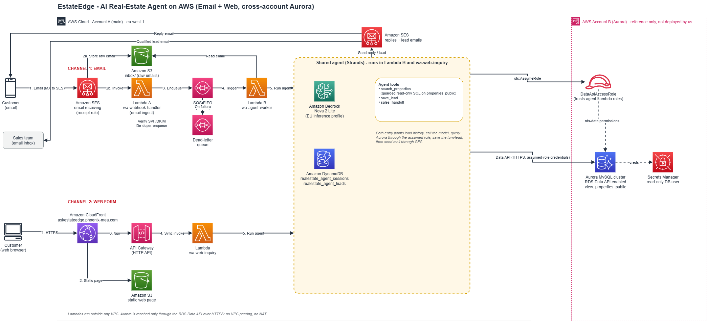
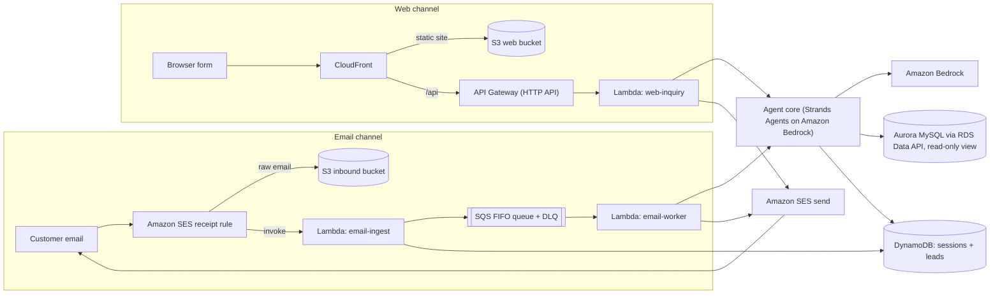

# EstateEdge — AI Real-Estate Assistant on AWS

A "chat with your data" assistant for real-estate listings, on AWS, built by
Phoenix. Customers reach it by **email** or through a **web inquiry page**. An
Amazon Bedrock agent answers with real property listings from an Aurora MySQL
database, in the customer's own language, and replies over **Amazon SES**.
Qualified leads are emailed to the sales team.

The agent, guardrails and infrastructure are generic and **white-label**: brand,
currency, language and copy are all configuration. Point it at your own
customer-safe view and adjust the prompt. It ships configured as a real-estate
listings assistant using an example dataset.

You deploy it into **your own AWS account** by filling in **one file** and
running **one command**.

**Live demo:** https://askestateedge.phoenix-mea.com

**Jump to:** [Live demo](#live-demo-for-judges-and-testers) ·
[Architecture](#how-it-works) ·
[AWS CDS used at runtime](#aws-communication-developer-services-used-at-runtime) ·
[Deploy it yourself](#how-to-use-this-code-repo)

Licensed under **Apache-2.0** (see [`LICENSE`](LICENSE)).

---

## Contents

1. [Live demo (for judges and testers)](#live-demo-for-judges-and-testers)
2. [How to use this code repo](#how-to-use-this-code-repo)
3. [AWS Communication Developer Services used at runtime](#aws-communication-developer-services-used-at-runtime)
4. [How it works](#how-it-works)
5. [What gets deployed](#what-gets-deployed)
6. [Prerequisites](#prerequisites)
7. [Deploy script reference](#deploy-script-reference)
8. [Configuration reference](#configuration-reference)
9. [After deploying: manual steps](#after-deploying-manual-steps)
10. [Database setup](#database-setup)
11. [Agent tools and security model](#agent-tools-and-security-model)
12. [Repository layout](#repository-layout)
13. [Customising for your data](#customising-for-your-data)
14. [Local development](#local-development)
15. [Teardown](#teardown)
16. [Troubleshooting](#troubleshooting)
17. [Limitations](#limitations)
18. [License](#license)

---

## Live demo (for judges and testers)

A live instance is already deployed and running. You can test it two ways:

- **Web form:** https://askestateedge.phoenix-mea.com. Fill in your email, your
  name and a property request (for example *"a 2-bedroom apartment for sale in
  Faisal under 2,000,000"*). Matching listings render on the page and are also
  emailed via Amazon SES.
- **Email:** send an email to **agent@askestateedge.phoenix-mea.com** describing
  what you are looking for. You get a reply with matching listings.

> **SES sandbox note (important for testing).** The live account is in the
> Amazon SES sandbox, so replies are only delivered to **SES-verified**
> recipient addresses. The testing address **`testing@devpost.com`** has been
> added as a verified identity in our account, so replies to it will be
> delivered. If you test from another address, verify it first. (The web page
> shows the results inline even when the emailed copy cannot be delivered.)

The repository below deploys the **same system** into any account through
`template.yaml` and `scripts/deploy.py`. The live instance and this repo are
functionally identical.

---

## How to use this code repo

This is the step-by-step path for anyone who wants to clone the repo, set it
up and launch their own copy in their own AWS account. You fill in **one file**
and run **one command**. Nothing is shared with anyone else's deployment.

### Step 1: Check what you need

- An **AWS account** whose user or role can create IAM roles, Lambda, API
  Gateway, SQS, DynamoDB, S3, SES, CloudFront and CloudFormation resources.
- **AWS CLI v2**, the **AWS SAM CLI** and **Python 3.10+** on your computer.
- A **domain or subdomain** whose DNS you can edit, for sending and receiving
  email (for example `mail.your-domain.com`).
- An **Aurora MySQL** cluster with the **RDS Data API** enabled, in the region
  you will deploy to. No data of your own? Step 4 loads the included sample data.
- Access to an **Amazon Bedrock** model in that region. Open the Amazon
  Bedrock console, check the model is available to your account, and copy its
  model ID (or inference-profile ID).

### Step 2: Get the code

```bash
git clone <repo-url>
cd <repo-folder>
```

### Step 3: Check your tools and credentials

```bash
aws --version
sam --version
python3 --version
aws sts get-caller-identity
```

The last command prints the AWS account your deployment will go to. If it
fails, run `aws configure` (or select a profile) first.

### Step 4: Prepare the database

Use your own data (see [Database setup](#database-setup)), or try the
included demo data:

1. Enable the **RDS Data API** on your Aurora cluster.
2. Create a **read-only** DB user and store its username and password in a
   Secrets Manager secret. Keep the secret's ARN for Step 6.
3. Run `db/sample_data.sql` in your database (for example in the RDS query
   editor). It creates a small table called `sample_listings`.
4. In Step 6 set `SOURCE_TABLE=sample_listings`, and choose a name for the
   customer-safe view in `DB_TABLE` (for example `listings_public`).

### Step 5: Prepare email (Amazon SES)

1. Decide your `EMAIL_DOMAIN` (the domain SES sends from and receives for)
   and a `SES_SENDER` address inside it.
2. New SES accounts start in the **sandbox**: you can only send to verified
   addresses. In the SES console, verify your `SALES_TEAM_EMAIL` and the
   address you will test with.
3. Make sure you deploy to a region where SES supports receiving email.

### Step 6: Create and fill in your config

```bash
cp deployment.config.example deployment.config
```

Open `deployment.config` and replace **every** `<placeholder>`. An example of
the required keys (all values here are made up; use your own):

```ini
AWS_REGION=us-east-1
STACK_NAME=my-estate-agent
EMAIL_DOMAIN=mail.example.com
SES_SENDER=agent@mail.example.com
SALES_TEAM_EMAIL=sales@example.com
BEDROCK_MODEL_ID=<copy the ID from the Bedrock console>
DATA_API_CLUSTER_ARN=arn:aws:rds:us-east-1:<account-id>:cluster:my-cluster
DATA_API_SECRET_ARN=arn:aws:secretsmanager:us-east-1:<account-id>:secret:my-secret-AbCdEf
DB_NAME=my_database
DB_TABLE=listings_public
CURRENCY_CODE=<your 3-letter currency code>
SOURCE_TABLE=sample_listings
READONLY_DB_USER=<your read-only DB user>
BRAND_NAME=My Property Assistant
```

Every key is explained in the [Configuration reference](#configuration-reference).
`deployment.config` is git-ignored, so your values never leave your machine.
No secrets go in this file: the DB password lives in Secrets Manager and AWS
credentials come from your CLI profile.

### Step 7: Do a dry run

```bash
python scripts/deploy.py --dry-run
```

You should see `Dry run complete. Config is valid.` If you see
`Configuration errors`, the script lists exactly which keys to fix. A dry run
makes no changes in AWS.

### Step 8: Deploy

```bash
python scripts/deploy.py
```

The script shows the AWS account and region and asks you to confirm. It then
builds and deploys the stack, uploads the web page, asks whether to activate
the SES receipt rule set (read the warning it prints first), and finishes by
printing your stack outputs and the DNS records you still need.

### Step 9: Finish the setup

1. **Bedrock:** confirm model access for your chosen model in the Bedrock
   console. This is manual, per account and region.
2. **DNS:** add the DKIM and MX records the script printed. Skip this if you
   set `ROUTE53_HOSTED_ZONE_ID`, because they were created for you.
3. **Database view:** run `build/create_public_view.sql` as the database
   master user. It creates the customer-safe view and grants it to your
   read-only user.
4. **Cross-account database only:** if your Aurora cluster is in another AWS
   account, add the `WorkerRoleArn` and `WebInquiryRoleArn` from the stack
   outputs to that account's Data API role trust policy (see
   [Database setup](#database-setup)).
5. **SES rule set:** if you skipped activation in Step 8, activate it now
   (the script printed the command).

### Step 10: Test the email channel

From a verified address, email any address at your domain, for example
`hello@mail.example.com`. With the sample data, ask:
*"Do you have a 2-bedroom apartment for sale in Springfield?"*
A reply should arrive in your inbox. Answer it to check the conversation
carries on in the same thread. If nothing arrives, see
[Troubleshooting](#troubleshooting).

### Step 11: Test the web channel

Open the `WebUrl` the script printed, fill in the form with a verified email
address and ask the same question. The answer appears on the page and a copy
is emailed to you.

### Step 12: Clean up when you are done

```bash
python scripts/deploy.py --destroy
```

This deletes the stack and empties its buckets. Your database, DNS records
and SES identities are left as they were.

---

## AWS Communication Developer Services used at runtime

This project uses **Amazon SES**, an AWS Communication Developer Service
(CDS), as the customer communication channel. SES is **imported and actually
called at runtime on every customer interaction**. It is a core part of the
backend, not just named here. Inbound mail is received by SES, and every
outbound reply and lead hand-off is sent with the SES `SendEmail` /
`SendRawEmail` APIs.

| Direction | What happens | Where in the code |
|---|---|---|
| Inbound email | SES receives mail for `EMAIL_DOMAIN`. A receipt rule stores the raw message in S3 and invokes the ingest Lambda. | `template.yaml` (`AWS::SES::EmailIdentity`, `AWS::SES::ReceiptRuleSet`, `AWS::SES::ReceiptRule`) and `app/src/email_ingest.py` (reads the SES event) |
| SES client and sending | Creates the SES client and sends every reply, with threading headers and retries. | `app/src/email_sender.py`: `boto3.client("sesv2"/"ses", ...)`; `send_email()` calls `ses.send_email(...)`, or `ses.send_raw_email(...)` when `SES_API=ses` |
| Email-channel reply | The SQS-triggered worker sends the agent's answer to the customer. | `app/src/worker.py` (`lambda_handler`): `send_email(...)` via `send_reply(...)` |
| Web-channel reply | The web Lambda emails a copy of the answer shown on the page. | `app/src/web_inquiry.py` (`lambda_handler`): `send_email(...)` |
| Agent reply | The agent loop sends the customer reply. | `app/src/agent.py`: `send_email(...)` |
| Sales hand-off | When a lead is qualified, the agent emails the sales team. | `app/src/tools.py`: `trigger_sales_handoff` calls `send_email(..., is_handoff=True)` |
| Recipient check | The web form checks whether an address is SES-verified while the account is in the sandbox. | `app/src/web_inquiry.py`: `boto3.client("sesv2", ...)`, `ses.get_email_identity(...)` |

Backend entry points that exercise SES at runtime: `app/src/worker.py`
(`lambda_handler`, email channel) and `app/src/web_inquiry.py`
(`lambda_handler`, web channel).

To see it yourself: `grep -rn "send_email\|get_email_identity" app/src`.

---

## How it works





**Email channel.** A customer emails your agent address. SES stores the raw
message in S3 and invokes the ingest Lambda. The ingest Lambda drops spam,
viruses, failed SPF/DKIM/DMARC and automated mail (auto-replies, mailing
lists, your own address), de-duplicates on the email `Message-ID`, and puts
a pointer on an SQS FIFO queue (one message group per sender, so one
customer is handled in order). The worker Lambda reads the email from S3,
runs the agent, replies through SES (threaded to the original message) and
saves the conversation after the reply is sent. Qualified leads are emailed
to your sales team.

**Web channel.** The static form is served from S3 through CloudFront. The
form posts to `/api`, which CloudFront forwards to an **API Gateway HTTP API**
that invokes the web Lambda. The same agent runs synchronously, the answer is
shown on the page and also emailed through SES.

The agent "brain" is shared. Only the inbound adapter and the reply
transport differ.

<details>
<summary><b>Step-by-step request flow, with source files</b></summary>

#### Email channel

```
Customer email
  -> Amazon SES (receiving)
  -> S3 (raw email under inbox/)
  -> Lambda  app/src/email_ingest.py   (verify SPF/DKIM, de-dupe, enqueue)
  -> SQS FIFO (+ DLQ)
  -> Lambda  app/src/worker.py         (run the agent)
       -> Amazon Bedrock (agent reasoning + tool use)
       -> Aurora MySQL via RDS Data API (optionally cross-account, read-only view)
       -> Amazon DynamoDB (conversation history + leads)
  -> Amazon SES  SendEmail  (reply to the customer)
  -> Amazon SES  SendEmail  (qualified lead -> sales team)
```

#### Web channel

```
Browser form
  -> CloudFront (static site from S3) + /api route
  -> API Gateway (HTTP API)
  -> Lambda  app/src/web_inquiry.py    (same agent core, synchronous)
       -> Bedrock + Aurora Data API + DynamoDB
  -> answer rendered on the page AND emailed via Amazon SES
```

</details>

### Web channel implementation note

`template.yaml` fronts the web Lambda with an **API Gateway (HTTP API)** behind
CloudFront: CloudFront serves the static site from S3 and forwards `/api` to
the HTTP API. This works in restricted accounts and organizations, unlike a
public Lambda Function URL (`AuthType: NONE`), which some accounts block and
which would make the `/api` route return `403`. The `web_inquiry.py` handler
accepts both the API Gateway v2 (HTTP API) and Lambda Function URL event
shapes, so either front door works with no application code change.

### Agent engine

`AGENT_ENGINE=strands` (default) runs the Strands Agents SDK.
`AGENT_ENGINE=bedrock` runs the raw Bedrock Converse loop. If Strands cannot be
imported at runtime, the code falls back to the Bedrock engine automatically.
Both engines send replies through Amazon SES.

---

## What gets deployed

`template.yaml` (AWS SAM) creates all of this from your `deployment.config`.
`<stack>` is your `STACK_NAME`.

| Resource | Name | Purpose |
|---|---|---|
| Lambda (Python 3.12) | `<stack>-email-ingest` | Screens inbound mail, de-dupes, enqueues |
| Lambda (Python 3.12) | `<stack>-email-worker` | SQS-triggered; runs the agent and sends the reply |
| Lambda (Python 3.12) | `<stack>-web-inquiry` | Web form backend (synchronous, behind API Gateway) |
| API Gateway (HTTP API) | Created by the template | Receives the `/api` calls CloudFront forwards and invokes the web Lambda |
| SQS FIFO | `<stack>-inbound.fifo` + DLQ | Ordered per-sender processing; failed messages land in the DLQ |
| DynamoDB | `<stack>-sessions` | Conversation history, de-dup keys, rate-limit counters (TTL on `expires_at`) |
| DynamoDB | `<stack>-leads` | Qualified-lead details |
| S3 | `<stack>-inbound-<account-id>` | Raw inbound email; objects expire after 30 days |
| S3 + CloudFront | `<stack>-web-<account-id>` | Static web page and the `/api` route |
| SES | Domain identity (optional) and receipt rule set `<stack>-inbound` | Receives mail for `EMAIL_DOMAIN` |
| IAM | One least-privilege role per Lambda | Scoped to the resources above |
| CloudWatch Logs | One log group per Lambda | 30-day retention |

**Not created by the template (you bring these):** the Aurora MySQL cluster
with the RDS Data API enabled, its read-only DB user and Secrets Manager
secret, your domain's DNS (unless you use Route 53), and access to your
chosen Bedrock model.

The account ID in names and ARNs comes from the credentials you deploy with.
You never type it.

---

## Prerequisites

- An AWS account and the **AWS CLI v2** configured with credentials that can
  create IAM roles, Lambda, API Gateway, SQS, DynamoDB, S3, SES, CloudFront and
  CloudFormation resources.
- The **AWS SAM CLI** and **Python 3.10+** (to run the deploy script; the
  Lambdas run on Python 3.12).
- An **Aurora MySQL** cluster with the **RDS Data API enabled**, in the
  **same region** you deploy to, and a Secrets Manager secret containing the
  username and password of a read-only DB user.
- **Amazon Bedrock** model access enabled in your region (set
  `BEDROCK_MODEL_ID` to a model or inference-profile ID).
- A **domain** you control for sending and receiving email with Amazon SES.
- A region that supports **SES email receiving** and offers your chosen
  **Bedrock** model.
- Optional, for a custom web address: an ACM certificate **in us-east-1**
  (a CloudFront requirement).

---

## Deploy script reference

The step-by-step walkthrough is in [How to use this code repo](#how-to-use-this-code-repo).
This section is a reference for `scripts/deploy.py`.

`deploy.py` flags:

| Flag | Meaning |
|---|---|
| `--config <path>` | Use a config file other than `deployment.config` |
| `--dry-run` | Validate and render files only; make no AWS changes |
| `--yes` | Skip confirmation prompts (CI use) |
| `--skip-web` | Do not upload the web page |
| `--destroy` | Delete the stack (see Teardown) |

What the script does:

1. Validates `deployment.config` and refuses to continue if any `<placeholder>`
   is left.
2. Shows the AWS account and region it will deploy to and asks you to confirm.
3. Runs `sam build` and `sam deploy`, passing your values as stack parameters.
4. Renders `web/config.js` (branding) and `build/create_public_view.sql`
   (database view).
5. Uploads the web page and invalidates the CloudFront cache.
6. Offers to activate the SES receipt rule set (read the warning below).
7. Prints your stack outputs and the DNS records you still need.

---

## Configuration reference

Everything you set lives in **one file: `deployment.config`**. Format:
`KEY=value`, one per line, `#` for comments.

> **Never put passwords, access keys or tokens in this file.** The database
> password stays in Secrets Manager and AWS credentials come from your CLI
> profile.

### Required

| Key | Example shape | What it is and where it ends up |
|---|---|---|
| `AWS_REGION` | `<aws-region>` | Deploy region and the region in every generated ARN. Must be the same region as your Aurora cluster. |
| `STACK_NAME` | `<stack-name>` | CloudFormation stack name and the prefix of every resource (lowercase letters, digits, hyphens; max 20). |
| `EMAIL_DOMAIN` | `<mail.your-domain.com>` | The domain SES sends from and receives for. Used for the SES identity, the MX record and IAM. |
| `SES_SENDER` | `<agent@mail.your-domain.com>` | The From address. Must be inside `EMAIL_DOMAIN`. |
| `SALES_TEAM_EMAIL` | `<sales@your-company.com>` | Receives qualified-lead hand-offs. Must be SES-verified while your account is in the SES sandbox. |
| `BEDROCK_MODEL_ID` | `<model-or-inference-profile-id>` | The Bedrock model or inference profile ID. A regional prefix such as `eu.` or `us.` must match your region group. |
| `DATA_API_CLUSTER_ARN` | `arn:aws:rds:<aws-region>:<db-account-id>:cluster:<cluster-name>` | Your Aurora cluster. |
| `DATA_API_SECRET_ARN` | `arn:aws:secretsmanager:<aws-region>:<db-account-id>:secret:<secret-name>` | Secret holding the read-only DB user's credentials. |
| `DB_NAME` | `<database-name>` | Database the agent queries. |
| `DB_TABLE` | `<view_name>` | The customer-safe **view** the agent may query (letters, digits, underscore only). |
| `CURRENCY_CODE` | `<currency-code>` | 3-letter currency code (for example `USD`) for every price the agent quotes. Required: there is no built-in default. |

### Optional

| Key | Default | What it does |
|---|---|---|
| `AWS_PROFILE` | default credentials | AWS CLI profile used by the script. |
| `DATA_API_ROLE_ARN` | blank | Cross-account only: role in the database account to assume. Blank means same account. |
| `DATA_API_EXTERNAL_ID` | blank | External ID for that role, if you require one. Treat as sensitive. |
| `SES_SENDER_NAME` | blank | Display name on outgoing mail. |
| `SES_CONFIGURATION_SET` | blank | SES configuration set to attach to outgoing mail. |
| `CREATE_SES_DOMAIN_IDENTITY` | `true` | Set `false` if the domain identity already exists in SES. |
| `ACTIVATE_RECEIPT_RULE_SET` | ask | `true` activates the rule set without asking. See the warning below. |
| `ENABLE_WEB_CHANNEL` | `true` | `false` deploys the email channel only. |
| `WEB_DOMAIN` | blank | Custom web address, for example `<ask.your-domain.com>`. Blank uses the default CloudFront address. |
| `WEB_CERTIFICATE_ARN` | blank | ACM certificate for `WEB_DOMAIN`. Must be in `us-east-1`. |
| `ROUTE53_HOSTED_ZONE_ID` | blank | If set, DKIM, MX and web alias records are created for you. Otherwise the script prints them. |
| `WEB_REQUIRE_VERIFIED_RECIPIENT` | `true` | While in the SES sandbox the web form can only reply to verified addresses. Set `false` after SES production access. |
| `BRAND_NAME` | `Property Assistant` | Name used in the email sign-off, subject line and web page. |
| `COMPANY_NAME`, `COMPANY_URL` | blank | Shown in the web page footer. |
| `LANGUAGE_HINT` | reply in the customer's language | Extra language instruction for the agent. |
| `REPLY_TECHNICAL_ERROR` | built-in English text | What the customer sees if the agent fails. |
| `REPLY_RATE_LIMITED` | built-in English text | Auto-reply when a sender hits the rate limit. |
| `REPLY_TOO_LONG` | built-in English text | Auto-reply when a message exceeds `MAX_MESSAGE_CHARS`. |
| `WEB_HEADLINE`, `WEB_HEADLINE_ACCENT` | generic text | Headline and highlighted word on the web page. |
| `WEB_INTRO` | generic text built from `BRAND_NAME` | Intro paragraph on the web page. |
| `WEB_SUBMIT_LABEL` | `Get matching properties` | Text on the submit button. |
| `WEB_EXAMPLE_QUESTION` | generic hint | Example shown inside the question box. |
| `SOURCE_TABLE` | n/a | Base table behind your view. Only used to render the SQL file. |
| `READONLY_DB_USER` | n/a | DB user granted `SELECT` on the view. Only used to render the SQL file. |
| `AGENT_ENGINE` | `strands` | `strands` (Strands Agents SDK, bundled via `app/requirements.txt`) or `bedrock` (plain boto3). If Strands cannot be imported, the code falls back to `bedrock`. |
| `RATE_LIMIT_PER_HOUR` | `40` | Messages per sender per hour. |
| `RATE_LIMIT_PER_DAY` | `150` | Messages per sender per day. |
| `MAX_MESSAGE_CHARS` | `4000` | Longer messages get a polite "too long" reply. |

### Where do accounts, ARNs and regions go?

| What | Where you provide it | Notes |
|---|---|---|
| Region | `AWS_REGION` | Everything else (ARNs, clients) derives from it. Lambdas receive it from AWS automatically. |
| Your main AWS account ID | **Nowhere** | Taken from your credentials by CloudFormation. |
| Database account ID | Only inside the `DATA_API_*` ARNs | Only matters if the database is in a different account. |
| ARNs | `DATA_API_CLUSTER_ARN`, `DATA_API_SECRET_ARN`, `DATA_API_ROLE_ARN`, `WEB_CERTIFICATE_ARN` | Every other ARN is built for you. |
| Secrets | Never in the file | Database password: Secrets Manager. AWS credentials: your CLI profile. |

### Stack outputs

After deployment the script prints these (also visible in the CloudFormation
console): `WebUrl`, `WebApiUrl`, `InboundQueueUrl`, `IngestRoleArn`,
`WorkerRoleArn`, `WebInquiryRoleArn`, `InboundBucketName`, `WebBucketName`,
`ReceiptRuleSetName`, the DKIM records and the MX record.

---

## After deploying: manual steps

CloudFormation and the script cannot do these for you.

1. **Bedrock.** Confirm model access for your chosen model in the Bedrock
   console. This is manual, per account and region.
2. **DNS.** Add the DKIM CNAME records and the MX record the script prints.
   Skip this if you set `ROUTE53_HOSTED_ZONE_ID`. If you use a custom web domain, add the
   alias record to CloudFront as well.
3. **Verify addresses (sandbox).** New SES accounts are sandboxed: replies only
   go to verified addresses. Verify `SALES_TEAM_EMAIL` and any address you
   want to test with.
4. **Activate the receipt rule set.** Only **one** SES receipt rule set can
   be active per region and account. Activating yours **replaces** the
   currently active one. If you already receive mail with SES, merge rules
   by hand first.
5. **Leave the sandbox.** Request SES production access to email arbitrary
   customers. Then set `WEB_REQUIRE_VERIFIED_RECIPIENT=false` and run
   `python scripts/deploy.py` again.
6. **Cross-account Aurora.** If the database is in another account, add the
   deployed worker and web Lambda role ARNs (`WorkerRoleArn`,
   `WebInquiryRoleArn`) to that account's Data API role trust policy. See
   [Database setup](#database-setup).
7. **Database.** See the next section.
8. **Test.** Send an email to your `SES_SENDER` address, then open `WebUrl` and
   submit the form. If something fails, check the CloudWatch log groups and
   the DLQ.

---

## Database setup

You bring the database. The agent never queries your base table directly. It
queries a **view** that exposes only customer-safe columns, and it connects
with a **read-only** DB user. Internal columns (for example an ML price
estimate) are simply not in the view.

1. Enable the **RDS Data API** on your Aurora cluster.
2. Create a read-only DB user and store its username and password in a
   Secrets Manager secret. Put the secret's ARN in `DATA_API_SECRET_ARN`.
3. Edit the column list in `db/create_public_view.sql.tpl` so it lists only
   the columns you are happy to show customers and leaves out anything
   internal.
4. Run `python scripts/deploy.py`. It renders `build/create_public_view.sql`
   from the template and your config.
5. Run that SQL as the database master user (for example in the RDS query
   editor). It creates the view named `DB_TABLE` and grants `SELECT` on it to
   `READONLY_DB_USER`.

### Database in a different AWS account (optional)

Set `DATA_API_ROLE_ARN` and create that role in the database account.

Permissions policy:

```json
{
  "Version": "2012-10-17",
  "Statement": [
    { "Effect": "Allow", "Action": "rds-data:ExecuteStatement", "Resource": "<DATA_API_CLUSTER_ARN>" },
    { "Effect": "Allow", "Action": "secretsmanager:GetSecretValue", "Resource": "<DATA_API_SECRET_ARN>" }
  ]
}
```

Add `kms:Decrypt` if the secret uses a customer-managed KMS key.

Trust policy (use the role ARNs from the stack outputs):

```json
{
  "Version": "2012-10-17",
  "Statement": [
    {
      "Effect": "Allow",
      "Principal": { "AWS": ["<WorkerRoleArn>", "<WebInquiryRoleArn>"] },
      "Action": "sts:AssumeRole"
    }
  ]
}
```

If you use an external ID, add a `Condition` on `sts:ExternalId` and put the
same value in `DATA_API_EXTERNAL_ID`. The code asks for a 1-hour session, so
the role's maximum session duration must be at least 1 hour.

For a **same-account** database, leave `DATA_API_ROLE_ARN` blank. The
template grants the Lambdas the Data API and secret permissions directly.

---

## Agent tools and security model

The model never writes free-form SQL that runs unchecked, and it never writes
free-form DML. It can only call three tools:

| Tool | Purpose |
|---|---|
| `execute_property_search_sql` | The model proposes **one** read-only `SELECT`. `app/src/sql_guard.py` validates it (SELECT only, single view, at most 5 rows, forced `ORDER BY`, internal columns blocked) and then runs it through the RDS Data API. |
| `save_lead_qualification` | Stores qualification details (budget, city, district, bedrooms, unit type, purpose) in the DynamoDB leads table. |
| `trigger_sales_handoff` | **Emails** a qualified-lead summary to `SALES_TEAM_EMAIL` through Amazon SES. |

Safeguards:

- **SQL guard:** SELECT only, a single table or view, a capped result size
  (5 rows), a forced `ORDER BY`, and a block on internal columns.
- **Read-only database user and a view** as the real security boundary. The DB
  user can only `SELECT` from a customer-safe view, and internal columns (such
  as an ML price estimate) are simply not in it. See
  `db/create_public_view.sql.tpl`.
- **Mail hygiene:** SPF, DKIM, DMARC, spam and virus verdicts are enforced.
  Loop protection ignores auto-replies, bulk mail and your own address.
- **Cost protection:** per-sender hourly and daily rate limits, a maximum
  message length, a per-message time budget and bounded model retries.
- **Privacy:** customer email addresses are masked in logs, raw inbound email
  expires from S3 after 30 days, and conversation history expires from
  DynamoDB after 30 days.
- **Web form:** honeypot field, per-email rate limit, and the SES sandbox
  recipient guard.
- **Least-privilege IAM:** one role per Lambda, scoped to the exact resources
  it uses.

---

## Repository layout

```
.
├── template.yaml                  # AWS SAM template: the whole stack
├── deployment.config.example      # the ONE file you copy and fill in
├── .env.example                   # placeholders for local development only
├── .gitignore                     # keeps deployment.config, build/, .env out of git
├── LICENSE                        # Apache License 2.0
├── docs/
│   └── architecture.png           # architecture diagram shown in this README
├── scripts/
│   └── deploy.py                  # validate, build, deploy, render, upload
├── app/                           # everything that is packaged into the Lambdas (and nothing else)
│   ├── requirements.txt           # Lambda dependencies (includes strands-agents)
│   └── src/                       # Lambda application code (Python 3.12)
├── web/                           # static web inquiry page
└── db/                            # view template + optional sample data
```

### `app/src/`

| File | Role |
|---|---|
| `email_ingest.py` | Lambda: SES inbound email screening, de-dupe, enqueue |
| `worker.py` | Lambda: SQS-triggered email agent worker |
| `web_inquiry.py` | Lambda: web form handler (synchronous); accepts API Gateway v2 and Function URL events |
| `agent.py` | Picks the agent engine, keeps history and runs the loop |
| `agent_bedrock.py` | Bedrock Converse tool loop (fallback engine) |
| `agent_strands.py` | Strands Agents engine (default) |
| `tools.py` | The three agent tools (including the SES sales hand-off) |
| `sql_guard.py` | Validates model-written SQL |
| `db.py` | Aurora access through the RDS Data API (optional cross-account role, cached) |
| `schema.py` | Reads the live view schema for the prompt (with a fallback column list) |
| `prompt.py` | System prompt, built from your branding, currency and language settings |
| `memory.py` | DynamoDB sessions, leads, de-dupe and rate limiting |
| `email_parser.py` | MIME parsing, reply extraction, automated-mail detection |
| `email_sender.py` | SES sending with threading headers, retries and error classification |
| `config.py` | Central configuration (environment variables, local `.env`, optional Secrets Manager overlay) |
| `logutil.py` | Log helpers that mask customer data |

### `web/`

`index.html` is a single-page form that renders answers inline (Markdown,
with right-to-left support) and says an email copy is on its way. Branding
comes from a generated `web/config.js` (see `web/config.js.example`). The
default brand assets (`logo.png`, `favicon.ico`, `favicon-32.png`,
`apple-touch-icon.png`) can be replaced with your own; a `web/ASSETS.md` note
explains this.

### `db/`

`sample_data.sql` is optional, made-up demo data (table `sample_listings`) so
you can try the assistant without your own database.

`create_public_view.sql.tpl` is the template for the customer-safe view and
the `SELECT` grant.

---

## Customising for your data

1. **View:** list your customer-safe columns in
   `db/create_public_view.sql.tpl`.
2. **Schema hints:** `app/src/schema.py` holds per-column hints and a fallback
   column list for the shipped real-estate example. Replace them with yours.
3. **Blocked columns:** `app/src/sql_guard.py` blocks columns matching
   `prediction*`, `lat1` and `lon1`. Change this to your internal column
   names. (The view is still the real boundary.)
4. **Prompt:** `app/src/prompt.py` describes the assistant's role, tone and
   rules. Edit it for your domain. Branding, currency and language come from
   `deployment.config`.
5. **Branding:** `BRAND_NAME`, `COMPANY_NAME`, `COMPANY_URL`, plus your own
   logo and favicon files.

---

## Local development

`app/src/config.py` resolves every setting in this order: real environment
variables, then a local `.env` file (development only), then an optional
Secrets Manager secret named by `APP_SECRET_ARN`.

```bash
pip install -r app/requirements.txt
```

For local runs, create a `.env` with the same variable names the Lambdas
receive (see the `Config` class in `app/src/config.py`) and set `LOCAL_MODE=1`.
`LOCAL_MODE=1` keeps history and leads in memory and prints outgoing email to
the console, so you can exercise the agent with only Aurora and Bedrock
access. Never commit `.env`.

Why `app/`? `sam build` copies the whole code folder into every Lambda package and
ignores `.gitignore`, so the Lambda code lives in its own folder. That keeps
`deployment.config`, `web/` and `scripts/` out of the deployed functions.

Syntax check before committing:

```bash
python -m py_compile app/src/*.py scripts/*.py
```

---

## Teardown

```bash
python scripts/deploy.py --destroy
```

The script empties the S3 buckets (CloudFormation cannot delete non-empty
buckets), deletes the stack and warns you if your receipt rule set is still
active. Your Aurora cluster, database user, secret, DNS records and any SES
identity you created outside the stack are not touched.

---

## Troubleshooting

| Symptom | Likely cause and fix |
|---|---|
| Email arrives but no reply | Receipt rule set not active, MX record missing, or the sender is unverified while you are in the SES sandbox. Check the ingest and worker logs, then the DLQ. |
| Replies only reach some addresses | The SES account is in the **sandbox**, so mail is only delivered to verified identities. Verify the address, or request production access. |
| Web form says it can only reply to pre-approved addresses | The sandbox recipient guard. Verify that address in SES, or get production access and set `WEB_REQUIRE_VERIFIED_RECIPIENT=false`. |
| Web form `/api` returns `403` | A public Lambda Function URL is being blocked by an account or organization policy. The shipped template uses API Gateway (HTTP API) to avoid this, so check that the front door has not been switched back to a Function URL. |
| Web form times out on long questions | The API Gateway HTTP API waits at most 30 seconds for the Lambda. Shorten the question or retry. |
| `AccessDenied` when assuming the database role | The trust policy does not list the stack's role ARNs, or the external ID does not match. |
| `Missing required configuration: ...` in logs | A Lambda environment variable is blank. Re-check `deployment.config` and redeploy. |
| Model errors | The model is not available in your region, access is not enabled in the Bedrock console, or the inference-profile prefix does not match your region group. |
| Messages piling up in the DLQ | Open one, read the worker log for the same time, fix the cause, then redrive from the SQS console. |

---

## Limitations

- The agent queries **one table or view** per request and is read-only.
- The database must be **Aurora MySQL with the RDS Data API**, in the **same
  region** as the Lambdas (it may be in another account).
- Only **one SES receipt rule set** can be active per region and account.
- The web form is synchronous, so very slow answers can hit the 30-second API
  Gateway HTTP API limit. The email channel is asynchronous and not affected.
- Auto-reply texts are plain English by default; change them with the `REPLY_*`
  keys. Reply-prefix and auto-responder detection also understands Arabic mail.
- Costs depend on usage (Bedrock tokens, SES, API Gateway, Lambda, CloudFront).
  Set AWS Budgets alerts before you open the form to the public.

---

## License

Licensed under the Apache License 2.0. See [LICENSE](LICENSE).
